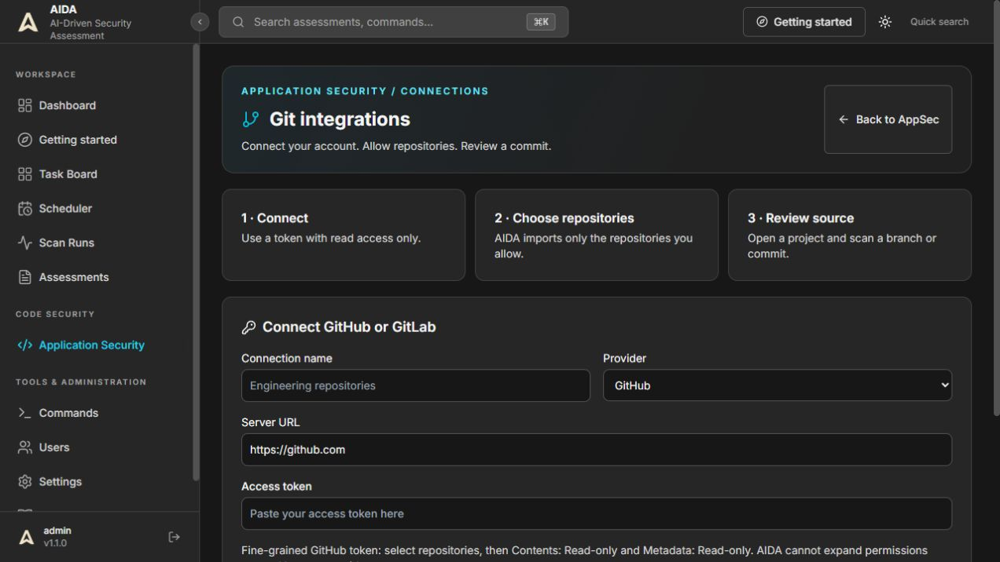
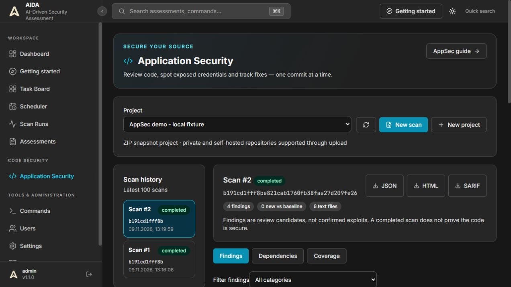
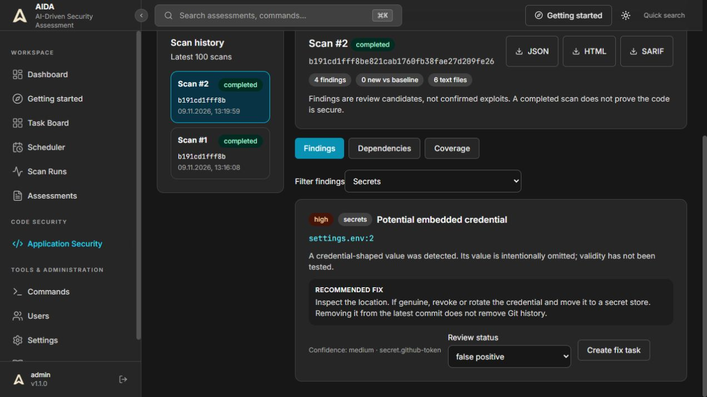
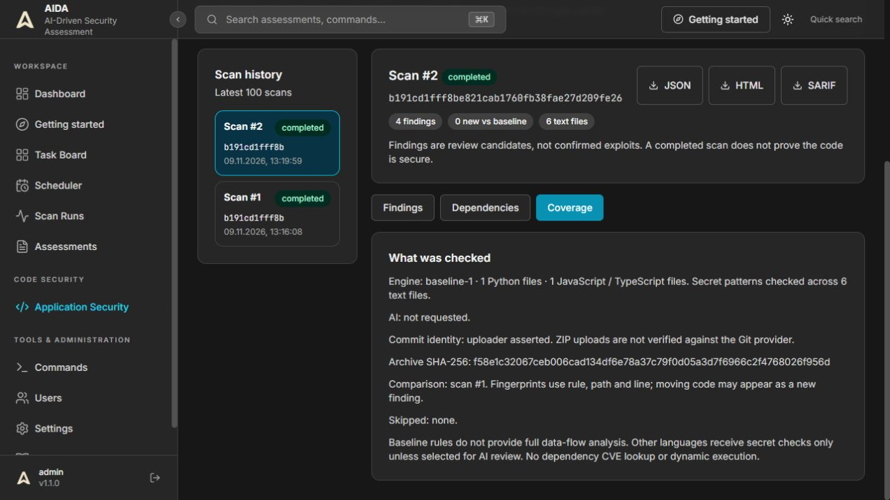

# Application Security

AppSec reviews a source snapshot without executing repository code. It is a separate workspace from network assessments and uses its own durable queue; the pentest runner can remain paused.

## First review

1. Open **Application Security → New project**.
2. Enter a project name. Optionally connect a public `https://github.com/owner/repository` or `https://gitlab.com/group/repository` URL. Nested GitLab groups are supported. Credentials in URLs are rejected.
3. Choose a branch, tag or full commit SHA. AIDA resolves it to an immutable provider commit before downloading the archive. For private repositories, connect a token under **Git integrations** as described below; ZIP upload remains available.
4. For a ZIP project, run these commands in your repository:

   ```bash
   git rev-parse HEAD
   git archive --format=zip HEAD -o source.zip
   ```

   Upload `source.zip` and paste the full 40-character commit SHA. ZIP uploads carry an **uploader-asserted** commit identity; AIDA does not verify their contents against the provider. An archive SHA-256 is recorded separately. Uploads should contain files at repository-relative paths, as produced by `git archive` without `--prefix`.
5. Leave **AI Review** off for local baseline analysis. Administrators can select an enabled model and explicitly authorize source transfer. This is separate from configuring a model in Settings.
6. Select **Start review**. For later reviews, open **New scan** beside the project selector. The page refreshes active scans every five seconds. Closing the browser does not stop a scan.

## GitHub and GitLab connections



The connection form shown above is ready for a token; it does not represent a connected account.

1. Open **Application Security → Git integrations** as an administrator.
2. Enter a connection name, select GitHub or GitLab and paste the token into **Access token**. Use **Check & connect** to verify its identity and save it.
3. Select repositories in **Available repositories**. Nothing is allowed automatically. Each selection creates an AppSec project. **Allowed repositories** also lets you revoke access when provider listing is unavailable.
4. Select **Open project**, choose a branch, tag or 40-character commit SHA, and start a review. AIDA resolves the ref and downloads that immutable commit. Repository code is never executed.

For GitHub, use a fine-grained personal access token restricted to selected repositories with **Contents: Read-only** and **Metadata: Read-only**. Organization approval or SSO authorization may also be needed. See [GitHub token permissions](https://docs.github.com/en/rest/authentication/permissions-required-for-fine-grained-personal-access-tokens).
For GitLab, use an access token with **read_api**. AIDA lists projects where the token identity is a member, in pages of 50. Search filters the current page. `read_repository` alone does not authorize the project-list API. See [GitLab token scopes](https://docs.gitlab.com/security/tokens/access_token_scopes/).

Cloud GitHub/GitLab and self-hosted GitHub Enterprise/GitLab HTTPS origins are supported. Enter the origin only, such as `https://gitlab.company.com`, without an API path. URL subpath deployments are not supported. Private-network servers require the explicit checkbox; loopback and link-local destinations are blocked. TLS verification stays enabled and the certificate must be trusted by the backend. Create another connection to use a different origin.

Only administrators can view or manage connections, tokens and repository grants. Auditors can scan allowed projects, and viewers can read results. **Projects and results are shared within the AIDA workspace.** Provider permissions are an upper bound: an AIDA checkbox cannot expand them. Grant only repositories intended for this workspace.

Tokens are encrypted with the backend secret key, never returned to the browser, and never passed to the analysis model. Back up the key securely alongside the encrypted database; losing or changing it can require replacing tokens. GitHub archive redirects are restricted and the personal access token is not forwarded to codeload. Provider response bodies are not included in errors.

Use **Replace token / reconnect** for rotation. The replacement is verified before the old credential changes. **Revoke access** stops new repository scans and cancels queued/running ones for that project. **Disconnect** removes the stored token and revokes all its grants. Existing projects and results remain available, and ZIP uploads remain independent. An in-flight download/model request may still finish; cancelled results are not published. Reconnecting does not automatically restore revoked grants. Deleting a token from AIDA does not revoke it at the provider or erase historical backups.

Administrator API routes under `/api/appsec/integrations`: GET/POST connections; POST `/{id}/check`; PUT `/{id}/token`; DELETE `/{id}`; GET `/{id}/repositories?page=1`; GET `/{id}/grants`; PUT `/{id}/repositories/{provider_id}` with `{"allowed": true}` or `false`. Repository metadata is fetched from the provider, not trusted from browser input. Send credentials in JSON bodies, never query strings.

## What the first release checks

| Check | Coverage | Interpretation |
| --- | --- | --- |
| Python baseline | AST checks for eval/exec, pickle/dill deserialization, subprocess shell=True and disabled requests/httpx TLS verification | Review candidates; no taint/data-flow analysis |
| JavaScript / TypeScript baseline | Text patterns for eval, innerHTML assignment and disabled TLS verification | Low-confidence candidates; comments and code context can produce false positives |
| Secrets | Private-key headers, GitHub token shapes, AWS access-key IDs and credential-like string assignments | Values omitted from findings; credential validity is never tested |
| Dependency inventory | package.json, modern package-lock.json packages, requirements*.txt | Declared constraints and locked versions; **no CVE/advisory lookup** |
| Optional AI review | Up to 20 code files and 40,000 characters; one request, 4,000 output-token cap, 90-second request deadline | Unverified low-confidence candidates with validated source locations |

AI-selected files are chosen in sorted path order among files that fit the context limit. This is a bounded first-pass review, not a whole-repository analysis. Provider token accounting varies; the output cap is not a monetary budget guarantee. Recognized secret patterns are redacted, but redaction cannot guarantee removal of all sensitive data. Enabling AI explicitly permits transferring selected source to the configured provider. No AI tool execution is available in this module.

Source limits: 10 MiB compressed, 20 MiB uncompressed, 5,000 ZIP entries, 512 KiB per analyzed file. Symlinks, binary/non-UTF-8 files and common generated directories (`.git`, `node_modules`, `vendor`, `.venv`, `venv`, `dist`, `build`, `__pycache__`) are skipped and counted in **Coverage**. Oversized archives fail; oversized individual files are skipped. Findings are capped at 500 baseline candidates plus up to 30 AI candidates. Dependency inventory is capped at 2,000 entries.

Other languages receive secret checks and optional AI review, not Python/JavaScript baseline rules. Submodules and LFS content are not fetched separately. History and removed commits are not scanned. Dependencies are never installed, application tests are never run, and no network requests are made to the application under test.

## Results and review

- **Queued / Running:** the AppSec worker is processing the request. There is one worker across backend processes, at most four queued/running scans globally and one active scan per project.
- **Completed:** the configured analysis finished. This is not a security certification or a guarantee of zero vulnerabilities.
- **Partial:** a requested check or parser did not complete, or a finding/inventory cap was reached. Successful baseline results remain available. Review Coverage before relying on the result.
- **Failed:** source acquisition or analysis failed. The reason is displayed; start a new scan after correcting it.
- **Cancelled:** results are discarded. An in-flight repository download or model request may still finish and incur provider usage.

Each finding records severity, confidence, rule, file, line, explanation, recommendation and review status. Choose **Open**, **Confirmed**, **False positive** or **Accepted risk**. Confirmed is a human triage decision, not an automated exploit claim.

**Create fix task** creates an idempotent Kanban task in **Backlog**. It does not queue an autonomous agent. The task contains the scan/commit reference and remediation context; it has no network scope. Configure any subsequent execution separately.

The latest previous completed scan is the comparison baseline. Fingerprints use rule/path/line (and AI title), so moved code may appear new. Matching finding review status and task links are retained on subsequent scans. Disappearance does not automatically certify remediation. History lists the latest 100 scans; projects are capped at 200.

Download **JSON**, **HTML** or **SARIF** after completed/partial analysis. Reports include review candidates; consumers must honor triage and scan completeness. SARIF marks partial analysis as an unsuccessful invocation. HTML is escaped and delivered with a restrictive content policy.

## API and CI entry point

All routes use AIDA's existing authenticated workspace permissions. Viewers can read and export; auditors/admins can create projects, upload, scan and triage. Only administrators can opt into source transfer to AI. Projects are shared within the AIDA workspace, not isolated per user.

| Method | Route | Purpose |
| --- | --- | --- |
| GET / POST | `/api/appsec/projects` | List / create projects |
| POST | `/api/appsec/projects/{id}/scans` | Queue public or allowed connected repository scan; JSON `ref`, optional `model_config_id` and `allow_source_to_model` |
| POST | `/api/appsec/projects/{id}/upload?commit=<40-hex-sha>` | Queue ZIP snapshot; raw `application/zip` body |
| GET | `/api/appsec/projects/{id}/scans` | Recent history |
| GET | `/api/appsec/scans/{id}` | Status, coverage and findings |
| POST | `/api/appsec/scans/{id}/cancel` | Discard queued/running work |
| PATCH | `/api/appsec/findings/{id}` | Set review `status` |
| POST | `/api/appsec/findings/{id}/task` | Create/reuse a Kanban fix task |
| GET | `/api/appsec/scans/{id}/report?format=json\|html\|sarif` | Download report |

The generic ZIP API can be called by CI jobs with a valid AIDA session bearer token and network access to AIDA. Dedicated CI service credentials, native GitHub/GitLab apps, webhook validation, PR/MR comments, diff-only scans and merge gates are **not implemented in this first release**. Do not publish the dashboard or reuse production credentials just to connect CI. A runner on the same trusted network can reach a private AIDA deployment.

## Storage and operations

AppSec adds `appsec_projects`, `appsec_scans`, `appsec_findings`, `appsec_git_connections` and `appsec_git_repositories` tables through the existing model initialization. It does not alter pentest tasks or assessments. Upload bodies are held in the database only while queued/running and cleared on completion, cancellation or failure. Findings, coverage and archive hashes persist. Database backups made while a scan is queued can contain uploaded source; normal backup access/retention rules apply. Source is never extracted into the application filesystem.

The AppSec worker uses a PostgreSQL advisory lock to prevent multiple backend processes claiming ownership. On worker takeover, interrupted running scans become failed instead of silently appearing complete. Queued scans remain queued. Cancellation is checked before result publication. Operator logs contain error types, not source or provider response bodies.

Public repository retrieval uses fixed HTTPS GitHub/GitLab endpoints without credentials, redirects or inherited proxies. Rate limits or private-repository errors appear as failed scans with ZIP upload as the fallback. No external service is needed for baseline ZIP analysis.

## Interface walkthrough

These screenshots show the synthetic **AppSec demo - local fixture**, captured on 9 November 2026. The code is intentionally unsafe and is never executed. The credential-shaped fixture is fake and was marked false positive during UI verification. No external AI request was made.



*Select a project, start a new scan and inspect an immutable source snapshot.*



*Findings include location, confidence, remediation and review status. Credential values are omitted.*



*Coverage records the actual checks, source provenance and comparison baseline.*
