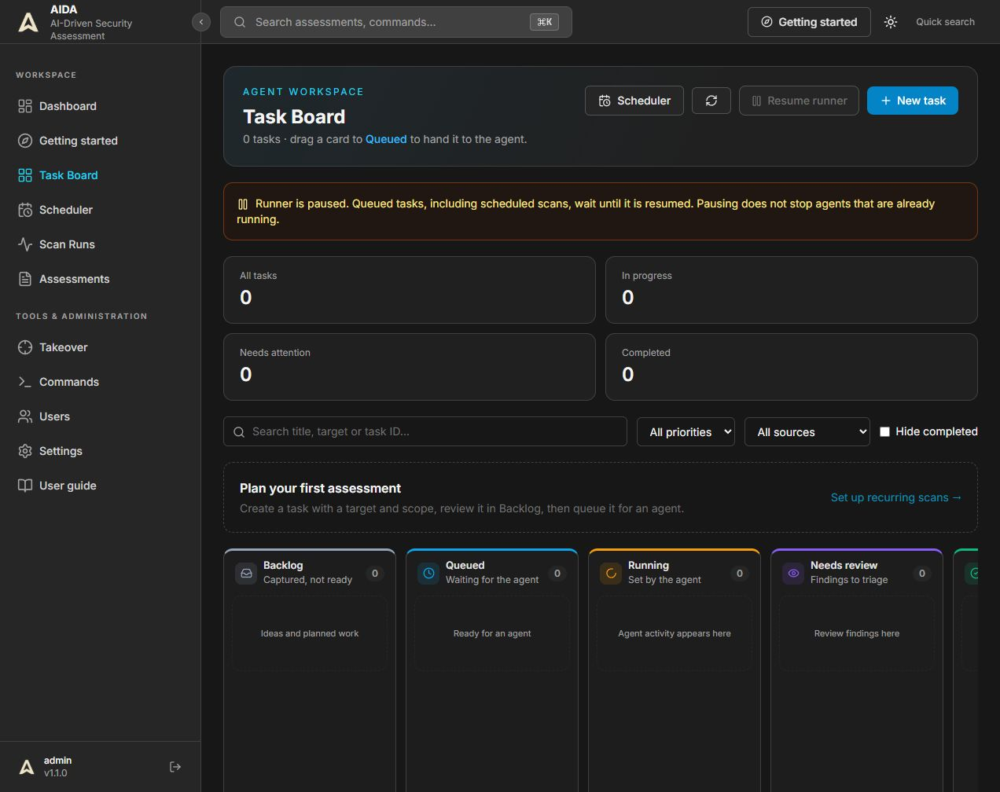
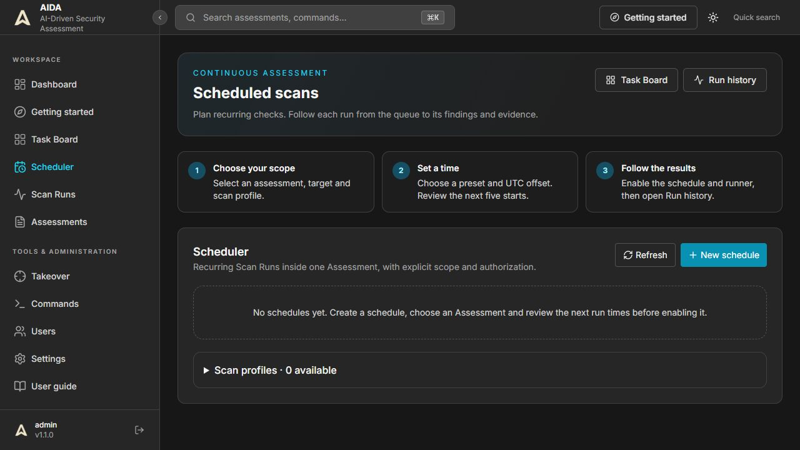

# Kanban and Scheduler

## Start a task

*Figure 1. Task Board on 9 November 2026. Empty columns are normal before tasks are created. On narrower displays, scroll horizontally to reach the remaining columns.*

1. Open **Task Board** and select **New task**.
2. Enter a useful title, exact target, authorized scope and objectives. Attach supporting context if needed.
3. Save to **Backlog** and review the task. Attachments finish uploading before a task can be queued. If upload fails, **Retry remaining steps** continues without creating another task.
4. Move the task to **Queued** by dragging it, or open its card with Enter and use **Move task to**.
5. An administrator can resume the runner. The **Runner is paused** banner means queued tasks wait; it is not a task failure.

| Column | Meaning | Next action |
| --- | --- | --- |
| Backlog | Planned work | Review scope and context |
| Queued | Ready for pickup | Check runner and model configuration |
| Running | An agent owns the task | Follow activity; stop if necessary |
| Needs review | Output needs an operator | Verify evidence and findings |
| Done | Workflow completed | Review results and reporting |
| Failed | Execution did not complete | Read the error, correct the cause, retry |

Running is assigned by the runner. Moving a task toward Running queues it instead. A completed workflow is not proof that a target has no vulnerabilities.

Search by title, target or ID and filter by priority/source. Dragging is disabled while filtering so hidden tasks do not distort ordering; use the card's status selector. API failures and version conflicts are shown rather than silently ignored. Viewers cannot modify tasks; runner controls require an administrator.

## Schedule recurring scans

*Figure 2. Scheduler with no schedules and no scan profiles configured. This is an empty state, not a completed scan or an error.*

Before creating a schedule, make sure an Assessment and a suitable scan profile exist. Expand **Scan profiles** to inspect or create profiles. If no profiles are available, configure one before attempting to save a schedule.

Open **Scheduler → New schedule**. Select an Assessment, target, scope and scan profile. Each run retains its own history while findings and evidence remain associated with the Assessment.

New schedules default to **UTC+00:00**. The selector offers fixed whole-hour offsets from UTC-12:00 through UTC+14:00, without country names. UTC+03:00 and UTC+05:00 are available directly. Offsets do not change with daylight saving time.

Existing regional IANA timezones are preserved when editing. They appear as an existing-timezone option and continue following their timezone rules until you explicitly choose a fixed offset. Fixed offsets use standard `Etc/GMT` identifiers internally; POSIX signs are reversed (`Etc/GMT-5` means UTC+05:00). The UI displays the ordinary UTC sign.

Choose a preset or enter a five-field cron expression:

| Expression | Schedule in the selected timezone |
| --- | --- |
| `0 3 * * *` | Daily at 03:00 |
| `0 */6 * * *` | Every six hours, at minute zero |
| `0 3 * * mon` | Mondays at 03:00 |
| `0 3 1 * *` | First day of each month at 03:00 |

Review **Next five runs** before saving. Preview never starts a scan. Dates without an offset in legacy API responses are interpreted as UTC, then displayed in the schedule's timezone. For example, 03:00 at UTC+05:00 corresponds to 22:00 UTC on the preceding date.

**Enabled** allows automatic scheduling. **Run now** queues one run immediately; it does not mean the scan has finished. Execution also requires the runner to be active. The scheduler's global setting is separate from the runner's setting. Overlapping active work in the same Assessment is skipped/rejected rather than intentionally piled up.

Use **Run history** or **View run** to inspect status, activity, evidence and findings. Pause a schedule to stop future automatic starts; stopping a currently running task is a separate action.

## Profiles

**Safe web baseline** performs bounded GET-only checks with explicit authorization, scope, page, response-size, timeout and request-spacing settings. It rejects redirects. It is not a full penetration test. **Autonomous** uses the configured AI model and execution tools. The external CLI's provider login and the built-in model configuration are separate.

## Troubleshooting

| Symptom | Check |
| --- | --- |
| Queued tasks do not move | Runner paused, model unavailable, dependency or approval pending |
| Preview unavailable | Five cron fields, valid timezone and API connection |
| Run now returns conflict | Another run is active in the Assessment |
| Times seem shifted | The displayed offset is the schedule's offset, not the browser's |
| Upload failed after saving | Retry remaining steps; the task stays in Backlog |
| Runner unavailable | Refresh and inspect backend health; do not assume it is enabled |

The scheduler polls periodically; the displayed time is the planned start, not a real-time execution guarantee.

## Pause, stop and retry are different actions

| Control | Effect |
| --- | --- |
| Pause runner on Task Board | Prevents new agent tasks from starting; agents already running continue. |
| Resume runner on Task Board | Allows eligible queued tasks to start. Review the queue first. |
| Stop agents on Task Board | Stops active agents through the global stop control. |
| Disable a schedule | Prevents its future automatic starts. It does not cancel a current run. |
| Cancel run in Scan Runs | Requests cancellation of the selected execution; its evidence is retained. |
| Retry run in Scan Runs | Requests another attempt after the cause of failure has been reviewed. |

Screenshots are documentation captures, not live status panels. No scans or sample schedules were started to produce them.
