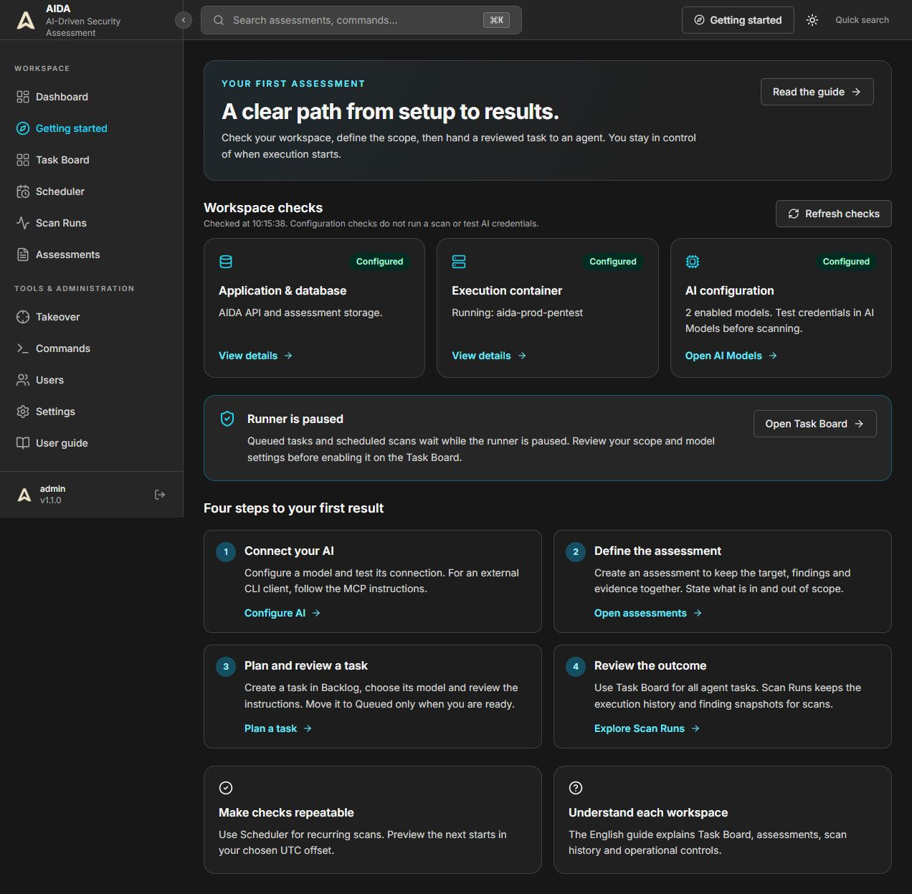
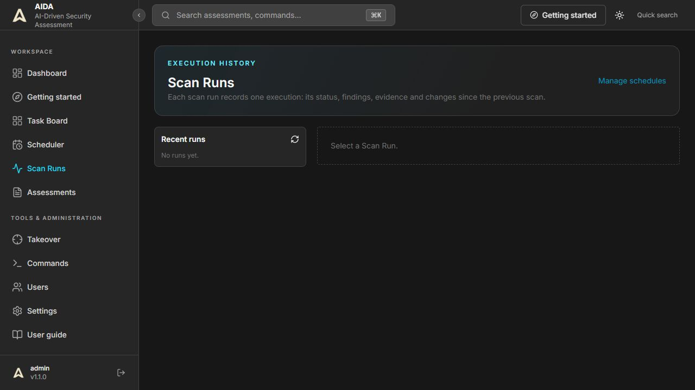

# Product guide

Updated for the interface released on 9 November 2026. Screenshots show the actual local installation; counts and available configuration vary by installation.

## Getting started and workspace checks

Open **Getting started** from the sidebar or **Workspace checks** on Dashboard. Refresh checks to read current API/database, execution container and AI configuration status. These checks do not run a scan, test AI credentials or enable the runner. An unavailable check is shown as **Not verified**, not success. Only administrators can inspect model configuration here; other roles are directed to the guide or an administrator.

Follow the four steps: connect an AI model or external CLI, define an assessment and its authorized scope, create and review a task in Backlog, then inspect its results. Settings links open the relevant tab directly and support browser Back/Forward.

On Task Board, **Resume runner** allows eligible queued tasks to start. **Pause runner** prevents new starts; running agents continue. **Stop agents** is the separate control for active work. Scan Runs records individual scan executions, evidence and finding changes; Task Board also includes general agent tasks.

The top bar includes a theme toggle. Navigation collapses on narrow screens and closes after choosing a destination. Keyboard users can use **Skip to content** and visible focus indicators.

*Figure 1. Configuration checks and the recommended path to your first assessment. Configured AI models still need a separate connection test.*

## The main workflow

An **Assessment** groups a target, authorization, findings, reconnaissance and evidence. A **Task** is work assigned to the agent. A **Scan Run** is a particular execution with its own history. A **Schedule** creates recurring runs. A **Scan Profile** defines execution limits and behavior.

1. Create an Assessment with an explicit target and scope.
2. Add work through Task Board, or configure a recurring scan in Scheduler.
3. Review queued work and enable the runner when ready.
4. Watch activity and command approvals.
5. Validate findings against evidence, then produce a report.

See [Kanban and Scheduler](KANBAN_SCHEDULER.md) for step-by-step instructions.

## Navigation

The sidebar can be expanded or collapsed with its button; your choice is remembered. Hovering does not move the page. Dashboard links lead to tasks, schedules and run history. Quick search opens the command/search palette. Keyboard focus is visible; drawers close with Escape and restore focus to their trigger.

## Assessment workspace

- **Reconnaissance** records hosts, endpoints and discovered technologies.
- **Cards** capture findings, observations and information. Findings should include reproducible evidence, severity and, where appropriate, a CVSS vector.
- **Commands and timeline** show what ran and its output. Review pending approvals before execution.
- **Credentials** provide named placeholders for supported tools. Do not copy secrets into ordinary notes or exported screenshots.
- **Context documents** supply source material to the workflow.
- **ASVS** assessments add a verification grid with PASS, FAIL, NA and NOT_TESTED. A blank grid may mean the Assessment uses a different methodology.

An Assessment's lifecycle and an individual task's state are different. Completing one task does not automatically mean every test in the Assessment has been performed.

## Results and reporting

*Figure 2. The empty Scan Runs screen is expected before the first scan execution. General tasks can exist on Task Board without appearing here.*

Select a run from **Recent runs** to inspect its status, finding changes and evidence. The HTML report action is available on a selected run. If the list is empty, use **Manage schedules** to configure a scan, or return to Task Board for general agent work. Creating a schedule does not mean a scan has already executed.

Use Run history to inspect a particular execution. Findings may be compared across runs; review changes against coverage and evidence before concluding that an issue is resolved. Reports use configured branding and export options. Choose a masked export when credentials are not required in the report.

Knowledge supports reusable context. Subdomain Takeover is a dedicated workflow: review its supporting evidence before treating a suspected takeover as confirmed. Neither an empty finding list nor a successful task is a guarantee of security.

## Accounts

Complete any required password change after login. If OTP is enabled, finish the second step with an authenticator or an unused recovery code. Provider authentication for an external AI CLI is independent of the AIDA account. Ask an administrator to diagnose permissions rather than repeatedly retrying a forbidden operation.

See [Administration](ADMIN_GUIDE.md), [AI CLI and MCP](AI_CLI_MCP.md), and [Operations](OPERATIONS.md) for configuration and troubleshooting.

## Quick troubleshooting

| What you see | What to do next |
| --- | --- |
| Not verified in Workspace checks | Use Refresh checks. Requests time out after 10 seconds; inspect Settings if the service remains unavailable. |
| Configured AI model but tasks fail | Open AI Models and use Test connection. A saved model is not proof of valid credentials. |
| Runner is paused | Review queued work, then ask an administrator to use Resume runner on Task Board. |
| No schedules yet | Create a scan profile if needed, then use New schedule. |
| No runs yet | No scan execution is recorded. Configure a scan or inspect general tasks on Task Board. |
| An action is unavailable | Check your role. Viewers are read-only; runner controls require an administrator. |

For a fresh installation or an update, see [Quick Start](QUICK_START.md). For recurring work, see [Kanban and Scheduler](KANBAN_SCHEDULER.md).

## Live scan progress and first schedule setup

An open, active Scan Run refreshes its status, findings, changes and event timeline every 10 seconds after the previous update finishes. Automatic updates stop when the run reaches a terminal status. Use **Refresh run** to fetch it again. If an update fails, the last successful results remain visible with a warning; AIDA retries automatically. Loading earlier events preserves them during subsequent updates.

The empty Scheduler provides three setup steps: create or choose an Assessment, choose custom scan settings or an optional reusable profile, and configure timing and authorized scope. **New schedule** becomes available after Assessment data loads and at least one Assessment exists. The readiness link opens Getting Started so you can check the runner before relying on scheduled execution.

Dashboard loading failures display an explicit error and a retry button instead of presenting unavailable statistics as zero. Command count and command success metrics are labelled as all-time totals.
