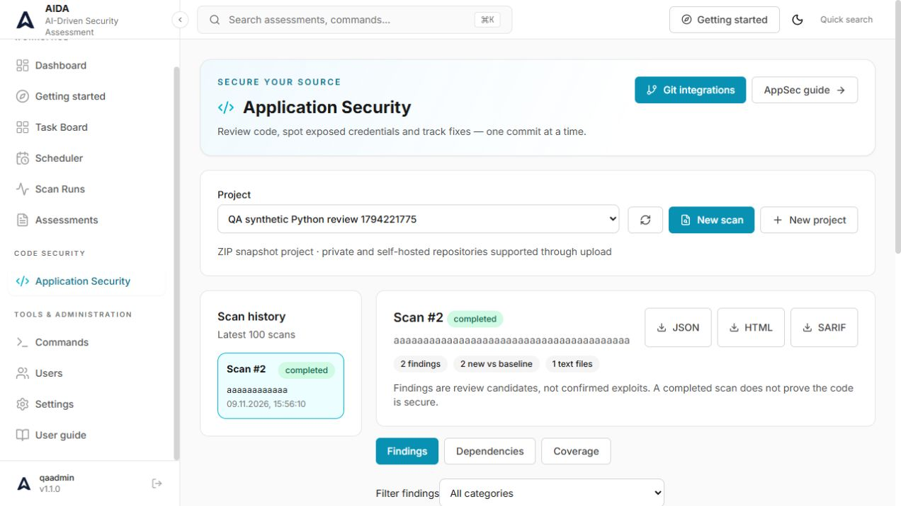
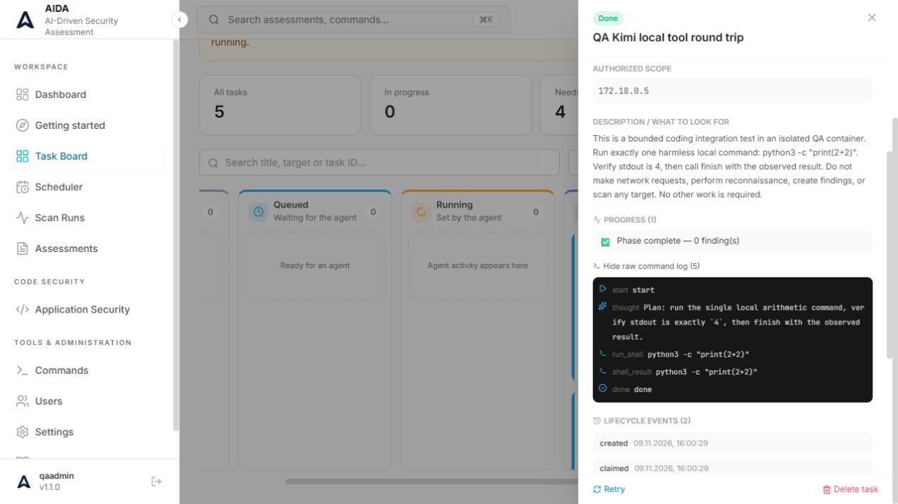

# Verification report — 9 November 2026

**Follow-up:** real GitLab, Keycloak SSO/OTP, SMTP and webhook checks are documented in the [live integration report](LIVE_INTEGRATION_QA.md). Its 1,322-test regression includes the additional SSO correction. The results and limitations below describe the earlier QA pass.

This report describes observed results, not a guarantee that every deployment, provider or target is defect-free. Tests used synthetic code and an explicitly scoped HTTP fixture. No customer repository or external target was scanned.

## Environment and results

An isolated PostgreSQL database, backend, frontend, HTTP fixture and nested Docker daemon ran on the Mac mini. The QA executor had no production Docker socket or host filesystem mount. Temporary model configurations were deleted after use.

| Area | Verification | Result |
| --- | --- | --- |
| Backend | Full suite against isolated PostgreSQL, final source | 1,319 passed; one intentional duplicate-ZIP warning |
| Frontend | Vitest and Node service tests; production bundle | 57 + 4 tests passed; build passed |
| Installer | Bootstrap unit tests and shell syntax | 4 tests passed; syntax passed |
| Database recovery | Dump and restore into a separate QA database | Restore succeeded; users, assessments and task row counts matched |
| Authentication | Real setup/login, TOTP enrollment/challenge, recovery-code consumption and disable | Passed on disposable QA account |
| Assessment execution | Real isolated pentest container, workspace and command history | Passed |
| Kanban | Task create/edit, stale-update rejection, comments, execution and completion | Passed |
| Scheduler | Time-zone preview, duplicate-run rejection, actual overdue timer dispatch | Passed |
| Finding lifecycle | First baseline: 7 findings; repeat: 7 recurring, no new findings; corrected fixture: 6 remediated | Passed; unrelated-agent regression fixed as described below |
| Kimi API | Actual Coding API connection using k3.1-pro | HTTP 200 |
| AppSec AI | Synthetic Python ZIP, baseline and actual Kimi review | Completed; 2 review candidates, 533 reported tokens |
| Built-in AI agent | Actual Kimi tool loop running a bounded Python arithmetic command | Done; stdout 4, exit 0; 2 model calls, 7,308 reported tokens |
| MCP HTTP | Initialize, session, tools/list, list_assessments, API-key revocation | 21 tools; call succeeded; revoked key rejected with 401 |
| Reports | Scan-run HTML and assessment PDF export | HTML returned; PDF signature validated (not a visual PDF layout audit) |
| Browser | Navigation, board task details, command log, AppSec results, settings tabs | Checked on QA frontend; screenshots below |
| Git integration | Provider protocol, grants, revocation, snapshot and failure-path tests | Automated coverage; no live private-account PAT supplied |

The full backend suite also exercises RBAC, scope enforcement, command approvals, cancellation, leases, budgets, goal/planner behavior, CRUD, archives, migrations, AppSec reports, Git access and integration failure paths. Some external boundaries are mocked; passing those tests is not equivalent to live service certification.

During a repeated frontend run alongside QA activity, three tests hit the default 5-second timeout. The final run used `npx vitest run --maxWorkers=2`: all 57 tests passed in 4.09 seconds, followed by all 4 Node service tests and a successful production build. No assertions were removed and no timeout was increased. Treat this as a test-resource/concurrency limitation to monitor in CI.

## Defects corrected

1. **Kimi Coding compatibility.** AppSec forced temperature 0, while the tested K3 model required 1. The provider now normalizes temperature for K3 on the exact supported Kimi Coding endpoints, exposes an international Kimi Code preset and preserves returned reasoning content across agent tool rounds. AppSec respects configured temperature for other models. Lookalike hosts and unrelated endpoints have regression coverage.
2. **UTC timestamps.** Naive API UTC timestamps were interpreted as browser-local timestamps, producing a five-hour error in Asia/Qyzylorda. A shared parser now treats naive ISO datetimes as UTC and preserves explicit offsets. Tests cover Qyzylorda, Tashkent, Moscow and UTC.
3. **False remediation after unrelated AI work.** Completing an arbitrary agent task could mark older findings remediated without rechecking them. Agent completion now records partial coverage; it cannot establish full remediation. The deterministic safe baseline retains explicit complete-coverage behavior. A regression verifies that an unrelated completed task leaves existing findings open and retains reasoning across tool rounds. The final full suite includes this regression.

One historical QA run predating the third fix temporarily closed findings; the next fixture run consequently reported a reopened finding. That history is retained in the QA evidence, not presented as a clean new baseline. The corrected behavior is covered by the regression and final suite.

## Screenshots

Synthetic AppSec review completed using the actual Kimi endpoint:

Completed bounded Kimi agent task and command evidence:

## Limits and follow-up validation

- Live private GitHub/GitLab repository listing, repository permissions and snapshot download still require a real account token and an authorized test repository. Automated provider tests passed.
- No live external SSO identity provider, SMTP/Slack/Telegram delivery or every third-party AI CLI was exercised. Those need their own credentials and service configuration.
- Installer checks and isolated container deployment passed; this run did not repeat a cold installation on every supported operating system or test public DNS/Let's Encrypt issuance.
- This is functional and regression verification, not a sustained load test, comprehensive browser/device matrix or independent security audit.
- Production runner settings are preserved. The test key was not made a production default and is absent from the source and documentation archives.

The Kimi model identifier and endpoint were checked against the [official Kimi Code model documentation](https://www.kimi.com/code/docs/en/kimi-code/models.html). Token counts above cover the named successful scenarios, not total account billing or all diagnostic calls.
